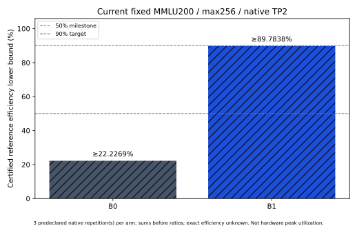

# 冻结 r8 本轮有效算力参考

固定 MMLU-Pro 200 题、输出上限 256，BF16、TP2、双 910B2；B0/E24、B1/E36，每臂三轮。封存的六轮原生同步计时和闭合 HTTP 观察经重新核验，一键流程 10/10 阶段通过、退出码 0。

| 项目 | B0 | B1 |
| --- | ---: | ---: |
| 三轮同步计时合计（秒） | 453.985942159 | 155.837258899 |
| 本轮必要算量下界（FLOP） | 5412318178236308 | 5412083385456264 |
| 原完整参考每卡上界（TFLOP/s） | 26.8182576764809057 | 19.3403833468717505 |
| 本轮达成率下界 | ≥22.2269% | **≥89.7838%** |

使用 `100 × C_current_lower / C_reference_upper`：本轮必要算量除以全部三轮同步墙钟，再除以独立复算的原完整参考每卡上界。双方各自的算量和参考时间均保留，不因算量不同而约分，也不沿用历史 59.7573%。这是原完整参考分母在严格同工况下的合格复用，认证类型为 `qualified_full_reference_denominator_reuse/v1`。

B1 已超过同口径 50% 里程碑；该下界不足以证明同口径 90%。精确效率和硬件理论峰值利用率未给出。这份 out256 参考不能用于 out8192 完整回答；完整回答质量仍由独立五项评测记录判断。



[HTML 报告](report.html) · [逐轮统计与来源哈希](compute-reference/matched-reference-pair.json) · [原完整参考统计](compute-reference/qualified-full-reference-statistics.json) · [六份必要算量及六份计时原件](current-work-and-timing.zip)

从仓库根目录复算：

```sh
python benchmark/reports/r8-compute-reference-20261119-v1/recompute.py
```

脚本核验 ZIP、逐项必要算量分量和原生时钟差值，独立重算原完整参考并重算两臂效率。此归档是该批算量、计时和审计结果的复算投影；全帧及 HTTP 记录的源封存哈希保留在认证中。第三方重新实测使用根目录 `run_all.py`，会生成本机完整原始记录及本轮报告。
