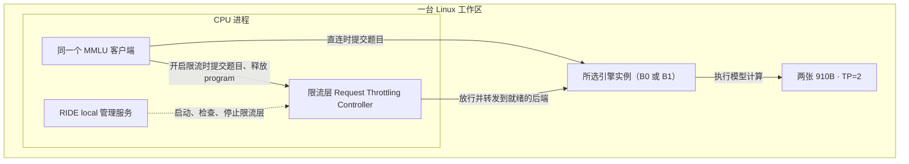

# B0、B1 直连与经 Request Throttling Controller 的真机验收

于 2026 年 11 月 24 日完成。实验目标是让引擎组与控制组使用同一条命令，分别选择引擎版本和请求路径。模型为 Qwen3.5-35B-A3B，整套验收顺序使用同一台分配了两张 Ascend 910B 的 Linux 工作区。

## 谁在运行，谁收到请求

从该工作区的 DeepLinkEngine 仓库根目录运行 `python deeplink.py benchmark`。选择 `--engine b0-original018` 或 `--engine b1-r8` 后，使用 `--route direct` 或 `--route request_throttling --controller-config FILE` 选择路径。每条命令独立拉起本组服务、发题、写回结果和收尾。

引擎仓的 `run_all.py --engine …` 和控制仓的 `run_vllm_hust_benchmark.py benchmark …` 都调用这里的单组入口。实机上三个入口生成的限流配置逐字节相同。原有的五项整套评测继续使用 `run_all.py --config evaluation.json`。

## 结果

固定 MMLU-Pro 200 题、每题最多生成 256 token、单实例 TP2。四组共 800 个请求均有可复核的原始流。两组限流分别记录到 200 次放行、200 次后端响应和 200 次 program 释放。RIDE 回执确认调度开启、后端与当前引擎匹配。

| 组 | 完整响应 | 非空 content | 仅 reasoning | 整批秒 | 输出 token/s |
| --- | --- | --- | --- | --- | --- |
| B0 直连 | 200/200 | 200 | 0 | 235.37 | 217.5 |
| B0 经限流层 | 200/200 | 200 | 0 | 234.11 | 218.7 |
| B1 直连 | 200/200 | 0 | 200 | 52.47 | 975.8 |
| B1 经限流层 | 200/200 | 0 | 200 | 52.39 | 977.3 |

B1 最终答案补验使用同一题单的第一题 `mmlu-pro-02804`，恢复原始 8192 token 上限。

- 直连收到 2108 个输出 token，以 `stop` 结束。最终文本 1779 个字符，提取答案 B，标准答案 B。
- 经限流层收到 2108 个输出 token，以 `stop` 结束。最终文本 1779 个字符，提取答案 B，标准答案 B。

逐字段计算 SHA-256 后，两个补验的最终文本相同，推理文本也相同。

首轮 B1 的 200 份 HTTP 200 原件均包含终止标记与 256 个推理 token。先前读取器要求非空最终文本，原批保留为失败。四个正式组都改用同一公开 MMLU 读取器重跑。评分仅读最终文本。有 content 的截断文本也可能是未完成的解题过程。单次短输出测量支持接口和路径验收。八实例、浦江冷部署、完整五项和多轮 Agent 性能另行验收。

实际运行的共享实现与各组命令见 [DeepLinkEngine PR #132](https://github.com/DeepLinkNext/DeepLinkEngine/pull/132)，Controller 侧兼容转发见 [Controller PR #7](https://github.com/vLLM-HUST/request-throttling-controller/pull/7)。本轮已完成 RIDE 和模型收尾、停止复用工作区并核对原 Pod 已消失。

## 复核与复现

B0 的实际 vLLM 为 `0.18.0`，B1 为 `0.28.1.post1.dev143+gf18cf803c`。本轮 B1 使用历史 R8 program-cache 的冻结运行环境。两个引擎的最大并行序列数分别为 24 和 36。批次用时从客户端发题到最后一个请求完成，限流组包含 program 释放，两种路径都单独记录引擎启动时间。

结构化记录包含每组原始流归档的 SHA-256、模型 HTTP 200 数、Controller 的逐请求事件数、输出长度、命中长度上限的题数、评分以及首 token 和整请求延迟分位数。两个补验各占一项，原始流可按归档摘要复核。

[逐请求回执（802 行 CSV）](requests.csv) 每行保留题号、客户端目的地、HTTP 状态、结束原因、输出长度和原始流摘要。经限流层的请求另列放行、后端回包、请求完成和 program 释放次数，直连组对应列留空。

[结构化验收记录](acceptance.json) · [依赖准备、八条独立命令和离线复核](../../unified-commands.md) · [设计和后续现场验收](https://github.com/DeepLinkNext/DeepLinkEngine/issues/129)
