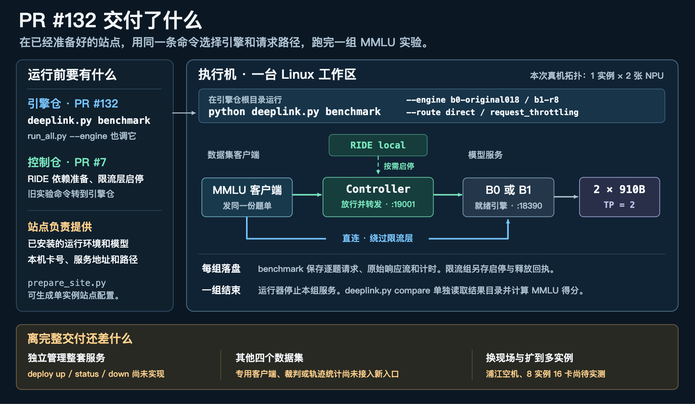

# 运行单组引擎与限流实验

在能管理引擎进程并能访问所有服务地址的站点执行机上，进入 DeepLinkEngine 仓库根目录。单机部署时，执行机就是分配到两张 NPU 的 Linux 工作区。每条命令启动所选引擎，等待模型就绪，提交同一批题，保存每个流式响应并收尾。单独评测用 `deeplink.py benchmark`。完整五项验收沿用 `run_all.py --config evaluation.json`。向 `run_all.py` 显式传入下面的 `--engine` 等单组参数也会调用同一个单组实现。

## 交付内容与代码位置



| 代码 | 改动和原因 |
| --- | --- |
| [deeplink.py](../deeplink.py)、[run_all.py](../run_all.py) | 给既有 CLI 增加单组 `benchmark` 和离线 `compare`。显式 `run_all.py --engine …` 分派到同一单组函数。已有五项套件继续走原代码。 |
| [prepare_site.py](prepare_site.py)、[serve_frozen_r8.sh](serve_frozen_r8.sh) | 将模型、卡号、地址和启动命令从实验配置拆出。前者用已有安装生成单实例站点文件、复用 B0 资产。后者校验并调用之前已制备的 R8 program-cache 环境。公开 R8 安装和历史冻结环境分别记录。 |
| [unified_run.py](unified_run.py)、[Controller 配置示例](../configs/request-throttling.example.json) | 共用同一批引擎端点：启动所选模型、等就绪。直连发到引擎。限流组把本组后端交给 RIDE，再把请求发到 Controller，每题释放 program。两条路径共用收尾代码。 |
| [流式客户端](profile_streaming_transport.py)、[离线评分](compare_groups.py) | 复用冻结的 MMLU 客户端，补入关联请求的追踪头，保留原始流，将推理文本与最终文本分别记录。`compare` 核验原题和评分器摘要，只从最终文本提取答案，汇总完成数、答对数与时间。 |
| [8192 协议](../experiments/mmlu-pro-200-out8192.json)、[256 短输出配置](../experiments/mmlu-pro-200-out256.json)、[回归测试](../tests/test_benchmark_routes.py) | 将完整回答与短输出服务测量分别命名，避免混用。覆盖正式协议参数、实例卡号冲突、后端绑定、两实例直连及仅返回推理文本的响应。 |

Controller 仓配套提供 RIDE 依赖准备、Controller 启停和兼容转调。新单组入口的 MMLU 路线已在单实例 TP2 实机验证。独立常驻服务的 `deploy up/status/down`、其他四个数据集在这个入口下的完整评价、浦江空机与八实例 16 卡的现场验收仍有缺口。[Controller PR #7](https://github.com/vLLM-HUST/request-throttling-controller/pull/7)

## 准备站点

原版 B0 的运行文件从仓库已有的 B0 镜像资产恢复；B1 使用已安装的发行版。以 R8、两张物理卡 6 和 7、容器内逻辑卡 0 和 1 为例。模型路径换成本站挂载位置。每个现场独立生成自己的站点文件。

```bash
python deeplink.py install --engine-version 2026.11.17.8.post2 --out /workspace/deeplink-r8
python tools/prepare_datasets.py --datasets mmlu --cache /workspace/deeplink-cache
python -m benchmark.prepare_site --installation /workspace/deeplink-r8 \
  --model /models/Qwen3.5-35B-A3B --physical-devices 6,7 --devices 0,1 \
  --cache /workspace/deeplink-cache --results /workspace/results --out sites/local.json
```

单组入口可从数据 Release 恢复 MMLU，并从原始题目顺序和请求正文重建输入。也可用站点的 `requests` 字段显式提供冻结 JSONL，两种方式都核对实验配置中的同一个 SHA-256。完整回答使用冻结协议的 8192 token 上限。已有的 out256 配置用于短输出服务测量。每题用独立 cache salt。

限流服务使用 Controller 仓库提供的 RIDE local 依赖制备与启停脚本。将下列变量指向本站实际的 Controller 源码和依赖清单。制备会核验源包摘要并安装依赖。把示例中 `runner` 和 `installation` 改为实际绝对路径。无需在每次运行前手工起服务。

```bash
python "$CONTROL_REPO/scripts/prepare_ride_dependencies.py" \
  --manifest "$DEPENDENCY_MANIFEST" --installation /workspace/ride-local
cp configs/request-throttling.example.json configs/request-throttling.json
```

[Controller 依赖制备及 RIDE local 启停脚本](https://github.com/vLLM-HUST/request-throttling-controller/pull/7)

## 单实例的四条命令

```bash
common=(--config experiments/mmlu-pro-200-out8192.json --site sites/local.json --tp 2 --replicas 1)
python deeplink.py benchmark "${common[@]}" --engine b0-original018 --route direct
python deeplink.py benchmark "${common[@]}" --engine b0-original018 --route request_throttling --controller-config configs/request-throttling.json
python deeplink.py benchmark "${common[@]}" --engine b1-r8 --route direct
python deeplink.py benchmark "${common[@]}" --engine b1-r8 --route request_throttling --controller-config configs/request-throttling.json
```

`--engine` 决定使用哪套服务启动配置。直连时，客户端把题发往模型的 `/v1/chat/completions`。限流时，入口将本组已就绪的模型地址写入 RIDE 配置，再启动 Request Throttling Controller。客户端向 Controller 发请求携带独立的 program ID，收到流后调用 `/programs/release`。模型请求、转发和等待恢复使用无限业务时限。服务冷启动另有就绪期限。

给任一命令加 `--dry-run` 可以在启动前检查引擎、站点、请求路径及实际端点。加 `--out /path/to/new-directory` 指定一个全新结果目录。默认目录在站点的 `results` 下。查看 `plan.json`、`measurement.json`、`status.json` 和各题的 `result.json`。限流组另有 RIDE 启停回执、服务日志和每个 program 的释放记录。

## 多实例的四条命令

站点文件的 `engines.<引擎>.instances` 每项填写 `host`、`physical_cards`、从执行机可达且互异的 `endpoint`、负责启动和收尾的前台 `argv`。站点需提供连接远程机器、启动对应进程及释放资源的能力。对同一主机检查卡号互斥。直连组依冻结题目顺序轮询多个后端，限流组将所有后端地址交给同一个 Controller。每个实例使用自己的 `{output}` 目录和 `{cards}`。八实例 TP2 需要 16 张 NPU。

```bash
pool=(--config experiments/mmlu-pro-200-out8192.json --site sites/pool.json --tp 2 --replicas 8)
python deeplink.py benchmark "${pool[@]}" --engine b0-original018 --route direct
python deeplink.py benchmark "${pool[@]}" --engine b0-original018 --route request_throttling --controller-config configs/request-throttling.json
python deeplink.py benchmark "${pool[@]}" --engine b1-r8 --route direct
python deeplink.py benchmark "${pool[@]}" --engine b1-r8 --route request_throttling --controller-config configs/request-throttling.json
```

本轮硬件验收范围为单实例 TP2。多实例站点和浦江的首次运行各自需要实际服务回执。夜间实验使用历史限流对照冻结的 R8 运行环境；上方站点制备示例使用公开 R8 安装包。两个现场的启动配置须分别留证。

## 复核结果

```bash
python deeplink.py compare --deployment /workspace/deeplink-r8/sdk \
  /workspace/results/b0-direct /workspace/results/b0-controller \
  /workspace/results/b1-direct /workspace/results/b1-controller
```

把目录替换成四次实际输出路径。离线复核使用安装包的原始答案和提取器，逐题检查请求正文和响应流摘要。输出包含计划题数、完成数、答对数、达到长度上限数、整批用时、输出吞吐、首 token 及完整请求延迟的 P50/P95。验收 Controller 的实际放行与后端绑定还应检查 RIDE 回执和服务日志。

复现已制备的 RIDE R8 program-cache 实验环境时，可以在站点 B1 的 `argv` 中指定 `bash benchmark/serve_frozen_r8.sh LAUNCHER RUNTIME {output}/worker DEADLINE`。四项分别为 RIDE 冻结启动包所在目录、已核验运行时目录、本次新目录和站点服务租约截止 Unix 秒数。适配器校验冻结清单的摘要，再调用 RIDE 原有的运行时复用、模型预检和前台启动逻辑。可共享的启动代码和校验值随本仓库交付，机器上的模型、已安装依赖及分配卡号由站点提供。

MMLU 客户端沿用 Controller 仓冻结的 [MMLU 流式读取实现](https://github.com/vLLM-HUST/request-throttling-controller/blob/3bf91fbb2b5cdd8fd0bd5de94774c26ca651eb35/experiments/vllm_hust_benchmark/website/profile_streaming_transport.py)，增加用于两端关联请求的跟踪头。流须包含 HTTP 200、结束原因、有效 token 用量及终止事件。首个输出 token 包含引擎返回的 `reasoning` 或最终文本，首个最终文本时间单独保存。评分只读 `content`。到达长度上限而仅返回 `reasoning` 时，单独统计为完整响应、零最终答案，保留原始流。

四组实测、逐请求限流证据及原始输出预算的单题补验见[2026-11-24 单实例 TP2 真机验收报告](reports/unified-mmlu-20261124/README.md)。
